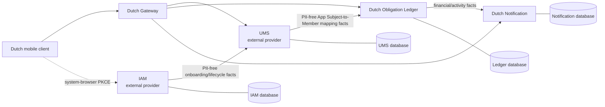

# Dutch architecture baseline

## Status and purpose

This is the Dutch product HLD baseline. It reconciles the settled Dutch MVP,
the portfolio capability registry, and the independent IAM and UMS efforts so
that implementation can begin without waiting for either provider's runtime.
It defines ownership, runtime boundaries, and the first buildable path; it does
not define endpoints, event payloads, broker technology, or database schemas.
Those belong to the integration LLD.

The Dutch requirements and architecture decisions are settled. IAM and UMS
provider requirements are settled in their own repositories, but neither
provider's production implementation is a prerequisite for Dutch domain work.
A conformant, visibly non-production development adapter can support the early
vertical slices. Real mobile onboarding and a releasable integrated environment
remain blocked until the relevant provider commitments are available and
validated.

## Authoritative boundaries

| Capability | Runtime owner | Repository authority | Dutch consumes or owns |
| --- | --- | --- | --- |
| Authentication, verified identifiers, app subjects, OAuth/OIDC, sessions | IAM | dedicated `iam` repository | consumes only a Dutch-bound authenticated App Subject and lifecycle facts |
| App-isolated profile foundation | UMS | dedicated `ums` repository | consumes profile readiness; Dutch-specific Member/placeholder/claim extension is reconciled before implementation |
| Shared-expense financial truth | Ledger | Dutch | owns Expenses, Splits, Settlements, Obligation Entries, balances, Activity, and financial authorization |
| Public request boundary | Gateway | Dutch | owns routing, coarse rejection, rate boundary, and correlation propagation; never domain authorization |
| Mobile experience and local presentation state | Dutch mobile | Dutch | owns UI, encrypted session presentation, local cache, and offline command UX; never server truth |
| Notifications | Notification | Dutch | owns preferences and best-effort delivery; never financial confirmation |

The portfolio capability registry records the consumer expectations for Ledger,
Gateway, and Mobile. It is a coordination source, not a replacement for the
versioned technical contracts that the LLD will publish.

## Container view

Every service owns its own database, transaction boundary, migrations, and
outbox. A service integration is an authenticated API call or immutable event;
there is no cross-service database access or distributed transaction. Gateway
routes one request to one authoritative service and never composes a financial
write across services.

## Principal and authorization model

IAM exposes a Dutch-specific **App Subject**, not IAM's global Human Identity,
to Dutch. This is the only principal identifier that crosses into Dutch's UMS,
Gateway, and Ledger contexts. IAM retains credentials and raw identifiers;
UMS retains app-local Member lifecycle; Ledger stores a local active
App-Subject-to-Member projection and makes the final financial authorization
decision.

The following states are deliberately independent:

- A person can be authenticated in IAM but still be `PROFILE_REQUIRED` in Dutch.
- A Dutch Member can exist without an active app session.
- Ledger denies financial access when its mapping is missing, inactive, or
  invalid, even when Gateway admitted an authenticated request.
- Existing local financial work can remain available through an IAM or UMS
  outage only under the separately specified token and projection rules;
  login, refresh, initial provisioning, identity changes, and claims pause.

Older Dutch documents that say `Identity-to-Member` refer to this app-scoped
mapping. The integration LLD will replace that legacy wording in contracts and
fixtures with `App Subject-to-Member`; Dutch must not expose or depend on IAM's
global Human Identity ID.

## Repository and delivery topology

Dutch retains its product-owned services, mobile application, Dutch contracts,
and the artifacts that describe them (container image, signal definitions, release
provenance). Production environment provisioning is a platform capability Dutch
consumes, not infrastructure Dutch owns. IAM and UMS are independently delivered
repositories.
Their schemas are imported at pinned versions; Dutch does not fork their
provider contracts or copy their runtime code.

The existing `services/iam` and `services/ums` modules in the Dutch repository
are development prototypes from the original monorepo plan. They may serve as
temporary adapter/reference evidence only. New provider behavior belongs in the
dedicated repositories, and no Dutch release may treat the prototypes as the
authoritative IAM or UMS deployment.

## First vertical path

The first path proves boundary integrity before financial behavior:

1. Mobile obtains a Dutch-bound session through either a conformant development
   adapter or IAM's real public-client flow.
2. UMS consumes the scoped onboarding fact and creates exactly one Dutch Member
   Profile, exposing an honest profile-required or profile-ready outcome.
3. UMS publishes a replay-safe App Subject-to-Member mapping fact.
4. Ledger applies that fact locally and fails closed until the mapping is active.
5. Mobile reaches the authenticated shell only after profile and mapping
   readiness are observable.

The next slice adds Group and Membership authorization; the first financial
command follows only after those foundations pass. Expense, Settlement,
Activity, recurring expense, and offline-sync work remain Ledger/Mobile slices
and can proceed behind the same development boundary.

## Integration LLD entrance criteria

Before the first real IAM/UMS integration, the LLD must pin and test:

- IAM issuer/discovery/JWKS and Dutch client/resource registration outcomes.
- The closed access-context claim profile and local resource validation rules.
- The onboarding, Member-mapping, security/lifecycle, replay, and snapshot
  recovery contracts—plus their producer and consumer fixtures.
- UMS ownership of the Dutch Member extension, including placeholder, Claim
  Offer, canonicalization, and lifecycle responsibilities.
- Gateway route/admission matrix and service-to-service authentication boundary.
- Idempotency, ordering, reconciliation, error, local-development, and
  non-production-adapter rules.

No provider commitment is implied by this HLD. A provider must explicitly
publish a planned commitment and later executable evidence before the dependent
path is considered available.

## Evidence needed to leave architecture work

Architecture is complete enough to begin implementation planning when the LLD
contains the pinned contract bundle and a single first-slice acceptance journey.
The journey must demonstrate delayed UMS provisioning, duplicate event delivery,
lost client response, app-subject mapping invalidation, and account/session wipe
without exposing raw identifiers, tokens, or a global IAM identity outside IAM.
