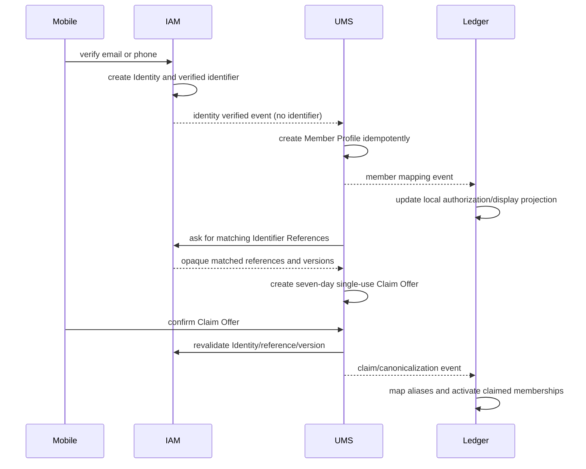

# IAM, UMS, and Ledger integration

## Decision

IAM is Dutch's OpenID Connect/OAuth authorization server and credential/identifier vault. Implement it as the IAM Spring service on Spring Authorization Server, extended with Dutch-owned verified email/phone, recovery, session, refresh-family, and risk controls. Spring Authorization Server provides the OAuth 2.1/OIDC foundation and PKCE support; Dutch supplies the application-specific credential and rotation lifecycle. [Spring Authorization Server overview](https://docs.spring.io/spring-authorization-server/reference/overview.html)

UMS owns Member Profiles, Placeholder Members, Claim Offers, canonicalization, and profile lifecycle. Ledger owns Group Membership and financial authorization. No service reads another's database; raw identifiers live only in IAM and never enter tokens, events, Ledger, or Notification.

OAuth uses authorization code with S256 PKCE in the system browser, exact registered redirect URI matching, and no mobile client secret. RFC 9700 requires PKCE support, recommends S256, and requires exact redirect matching apart from the native-app localhost exception. [RFC 9700](https://www.rfc-editor.org/rfc/rfc9700.html)

## Identity and identifier records

| IAM record | Purpose | Sensitive-data rule |
| --- | --- | --- |
| `identity` | permanent authentication principal and security status | UUID only leaves IAM |
| `verified_identifier` | verified email/phone, normalization/version/status | ciphertext plus keyed lookup digest; no raw event/token/log |
| `identifier_reference` | opaque reference to a Placeholder contact value | enables exact matching without UMS storing raw identifier |
| `credential` | password/passkey/recovery verifier metadata | IAM only |
| `session` / `refresh_token_family` | session state and rotating refresh-token replay detection | refresh token values stored only as hashes |

IAM normalizes an email or E.164 phone, computes a key-versioned HMAC lookup digest, and stores encrypted value/ciphertext where recovery/display of the value is necessary. The HMAC digest supports exact equality matching without exposing the contact value. Rotating a lookup key is an explicit reindex migration. Passwords use a modern adaptive password hash; refresh tokens are random opaque secrets stored only as hashes.

When a placeholder is created with a contact value, UMS calls IAM's mTLS-authenticated internal contact-vault operation. IAM creates an opaque `Identifier Reference` and returns only its UUID/status. UMS stores that reference with the Placeholder Member; it never stores the raw email or phone. The external client sends the contact value only over TLS to the Gateway/UMS request boundary, which immediately passes it to IAM and redacts it from logs/errors.

## Registration, profile, and claim flows

1. IAM verifies a contact method, creates/updates an Identity, and publishes a PII-free identity lifecycle event through its outbox.
2. UMS idempotently creates the Member Profile. Until that succeeds the Identity is `PROFILE_REQUIRED` and Gateway denies financial routes.
3. UMS requests an exact match against IAM-held Identifier References for the Identity's current verified identifier versions. It creates a Claim Offer—never an automatic merge—bound to Identity, Placeholder Member, reference ID/version, expiry, and single-use state.
4. Claim confirmation locks the Claim Offer, calls IAM to revalidate the identifier/reference/version and Identity security state, then commits the canonical/alias decision in UMS. The oldest confirmed Placeholder Member becomes canonical only during first registration; an existing registered Member remains canonical.
5. UMS publishes versioned `member.mapping.changed`/`member.canonicalized` events. Ledger applies them idempotently to its local projection, activates claimed Group Memberships where allowed, and records Activity. Ledger downtime makes activation pending; it never rolls back the confirmed UMS claim.

Any identifier removal/reassignment, security lock, deletion, or reference version change invalidates dependent Claim Offers. Matching/verification/recovery responses remain generic and centrally rate limited to prevent identifier enumeration.

## Tokens, session, and authorization

IAM publishes a JWKS endpoint and signs short-lived (maximum 15 minute) access tokens. A token contains only immutable authentication context: issuer, audience, subject/Identity ID, session ID, issued/expiry/not-before times, authentication time/method, and token ID. It contains no Member ID, email, phone, profile, Group, role, or financial scope.

The Expo mobile client is a public OAuth client. It runs external-browser authorization code + S256 PKCE with an exact registered app redirect. It stores access/refresh material only in OS SecureStore. Refresh tokens rotate on every use; reuse revokes the entire family/session, triggers a security event, and requires reauthentication. Absolute session lifetime is 30 days; refresh, recovery, identifier changes, Privacy Export, deletion, and recovery-capable credential changes require recent reauthentication as already specified.

Gateway performs coarse token/rate checks. UMS and Ledger independently validate signature, key ID, issuer, audience, expiry/not-before, session/Identity security state, and local deny-list events. Ledger maps the trusted Identity ID to its local UMS-fed authorization projection, resolves canonical aliases, then checks its current Group Membership. Missing, stale-invalid, locked, or inactive mappings fail closed. An inaccessible Ledger resource returns a non-enumerating `404`.

## Local projections and event recovery

Ledger stores only two UMS-fed projections:

- `identity_member_mapping`: Identity ID, canonical Member ID, aliases, lifecycle state, and monotonic mapping version.
- `member_display_reference`: Member ID, display name/avatar reference, lifecycle/display version.

Each consumer records event ID and producer/version with its local effect. Gaps/out-of-order events trigger a purpose-specific authenticated UMS snapshot repair, not a cross-service database read. IAM security lock/revocation facts similarly update local deny lists. Existing unexpired tokens and valid local mappings keep financial work available through an IAM/UMS outage; verification, refresh, profile completion, identifier changes, and claims pause when their authoritative owner is unavailable.

## Deactivation and final deletion

- **Security lock:** IAM revokes sessions and publishes lock state; Identity cannot authenticate. Financial evidence remains unchanged.
- **Deactivate:** IAM revokes sessions; UMS marks profile inactive and publishes mapping/display state. Ledger removes acting access but preserves historical Group visibility/balances according to membership rules.
- **Delete:** IAM revokes access immediately and begins the settled 30-day recovery window. After it expires, IAM deletes credentials/identifiers and UMS anonymizes profile data. UMS publishes `member.anonymized`; Ledger retains immutable Member IDs/evidence but renders Former member and removes avatar references. Re-registration is a new Identity and Member, never a silent re-claim.

## Security controls and tests

- IAM signing/encryption keys and service credentials come from KMS/Secrets Manager; signing-key rotation preserves published verification keys through token expiry. Internal calls use mTLS/service identity and narrow scopes.
- Request schemas, identifier/value size limits, generic errors, redacted logs, IP/Identity/device rate limits, progressive cooldown, and alerting cover verification, claim, recovery, and refresh abuse.
- Test exact PKCE S256/redirect matching, token validation/deny-list behavior, refresh-family reuse, key rotation, identifier enumeration resistance, claim races/expiry/reference invalidation, canonicalization replay/out-of-order recovery, UMS/Ledger outage behavior, and final anonymization/cache wipe.
