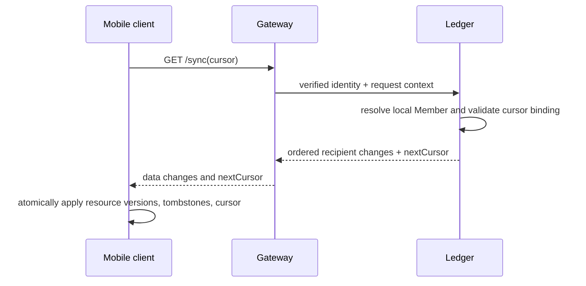

# Ledger read and sync model

## Decision

Ledger maintains service-owned, rebuildable mobile projections and a recipient-scoped change journal. Each committed Ledger action updates the affected projection and appends a minimal change record for every Member authorized to receive it in the same Ledger transaction. Mobile sync reads that member's journal in sequence order; it never queries immutable Obligation Entries or infers authority from a locally cached record.

This deliberately trades bounded write fan-out for simpler authorization, deterministic tombstones, and correct offline recovery. Group membership is capped at 100 and financial write capacity at 20 RPS, so this is appropriate for the MVP. Reassess only from measured journal-write/size evidence.

## Projection boundary

| Projection | Purpose | Source of truth |
| --- | --- | --- |
| Home | per-currency balances, next actions, recent activity summary | immutable entries and Activity |
| Group | membership/access state, balances, simplified plan, Expense/Settlement summaries | Group/Membership/source records and entries |
| Direct Expense | one-off source/history and its participant visibility | direct Expense revisions and entries |
| Activity/History | attributable, privacy-filtered evidence navigation | immutable Activity/source records |
| Recurring Series/Occurrence | current template/status and reviewable pending items | series/occurrence source records |

Projections expose mobile resources, not `ObligationEntry`, internal lock/stream IDs, identifiers from IAM, contact data, outbox data, or database errors. Their resource schema/version is owned by Ledger and is separately contract-tested.

## Recipient-scoped change journal

`member_sync_change` is an append-only table with a per-recipient monotonic `sequence`. Each row contains:

- recipient Member ID;
- sequence, resource type and resource ID;
- operation (`upsert`, `tombstone`, `access_changed`, or `full_resync_required`);
- immutable resource version and compact resource representation, or a tombstone with no stale private payload;
- source Activity/action ID, server-recorded instant, schema version, and correlation ID.

The Ledger transaction that changes a projection determines its visibility audience from locked, local authorization state and appends one change row for each authorized recipient. For a Group action this is its allowed active/inactive historical audience as appropriate; for a Direct Expense this is every Member who has ever participated in a surviving revision plus actors with allowed settlement evidence. A privacy-sensitive Activity variant is rendered per recipient before it reaches the journal.

Membership becoming Inactive emits an `access_changed` resource with a read-only capability, not a cache tombstone, because historical Group access remains. Genuine loss of a scope's authorized visibility emits a recipient-only tombstone in the same transaction as the access change. A whole-identity logout, account switch, security lock, or revocation requires client-side cache/draft wipe and fresh authentication; it is not solved by retaining a stale cursor.

## Cursor contract

`GET /api/v1/ledger/sync?cursor=<opaque-token>&limit=<n>` returns an ordered page of the caller's own changes plus `nextCursor`. The opaque signed cursor contains only:

- cursor format version and signing-key ID;
- opaque recipient-feed ID and authorization epoch binding;
- last delivered journal sequence;
- issued/expiry times and feed/schema generation.

It contains no balance, resource contents, raw contact identifier, Activity text, or list of scopes. Gateway/Ledger resolves the JWT Identity to a local Member, verifies the signed binding and authorization epoch, then reads only that Member's journal rows. Clients must treat it as opaque and never construct or modify one.

Cursors and journal history are retained for 90 days. A cursor below the retained watermark, for another recipient/authorization epoch, expired, malformed, or tied to an incompatible sync schema returns `409 sync_cursor_expired`; the error reveals no hidden scope/resource detail.

## Incremental and full synchronization

Each sync page is bounded by record count and response bytes. The client writes all changed resources, tombstones, and the replacement cursor to SQLite in one local transaction. It applies an upsert only when its resource version is newer than local state; a tombstone wins at its version. It never advances the cursor separately from the page.

For an initial or expired cursor, `POST /api/v1/ledger/sync-snapshots` creates a 15-minute, recipient-bound snapshot token containing an `asOfSequence` and active projection generation. Paginated snapshot reads return the caller's then-authorized projections with each resource version. On completion the client stores the cursor at `asOfSequence` and immediately runs incremental sync. A projection updated after `asOfSequence` may appear in the snapshot and be repeated in incremental sync; resource-version application makes that harmless. No update can be skipped.

The snapshot token is signed, recipient-bound, rate-limited, and not reusable after expiry. Full sync retains Local Drafts but blocks finance submission until the relevant scope's projection is refreshed and reviewed.

## Projection rebuild and recovery

Immutable source/entry records rebuild a shadow projection generation. Reconciliation compares resource counts, entry-fold totals, effective stream versions, and Group plan algorithm versions before an atomic activation. Normal rebuilds preserve journal sequence and cursor semantics because resource versions remain monotonic.

An incompatible client projection/schema changes the sync-feed generation. Ledger returns `sync_cursor_expired`, requiring the full-sync route; it does not reinterpret cached data. A failed journal/projection write rolls back with the source action, while an outbox/event delay does not prevent the local projection/journal commit.

## Security and operational rules

- Validate opaque cursor, limit, snapshot token, and all query data with allowlisted schemas; parameterize every database query. Do not log tokens, cursor payloads, projection contents, or raw identifiers.
- Reevaluate identity and current local authorization for every request. The journal audience is an optimization and audit record, not authorization by itself.
- Apply per-Identity and per-IP limits to incremental and full sync; full snapshot creation is stricter. Return generic errors for invalid/foreign cursor material.
- Monitor journal fan-out, rows retained, cursor-expiry rate, full-sync rate/duration, tombstone delivery, projection-vs-source reconciliation variance, and authorization-denial anomalies.

## Required tests

1. A Member receives only their own recipient changes, including privacy-filtered Activity; forged, foreign, stale, and altered cursors disclose nothing.
2. Applying a page and cursor atomically survives a device crash without skipping or duplicating resource state.
3. A Group removal that preserves history becomes read-only; a true revocation delivers a tombstone and wipes the scope cache.
4. Delayed, duplicate, reordered (across resources), and replayed journal pages converge by immutable resource version/tombstone rules.
5. Initial/full sync concurrent with writes converges after its `asOfSequence` incremental catch-up; expired retention and incompatible generation force the documented full-resync state.
6. Rebuilt projections reconcile with entries and preserve cursor semantics; a failed rebuild never becomes active.
