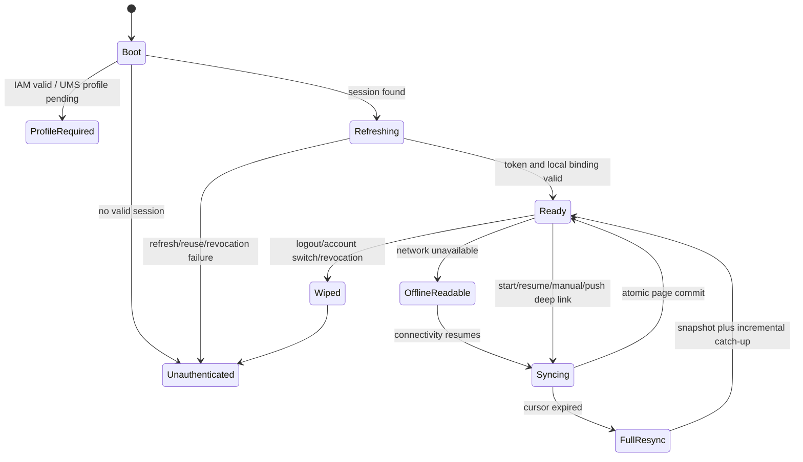

# Mobile client architecture

## Decision

Build `apps/mobile` as a TypeScript Expo development-build application using Expo Router with native stack navigation and native tabs. SQLite is the durable store for authorized Ledger projections and Local Drafts; SecureStore holds only IAM session/refresh material. The app is one cross-platform client, but platform controls, safe areas, accessibility semantics, and release builds remain native to iOS and Android.

## Application structure

```text
apps/mobile/
├── app/                         # Expo Router route layouts only
│   ├── (auth)/
│   ├── (tabs)/                  # Home, Groups, Activity
│   └── groups|expenses|settlements|series|settings/
├── src/
│   ├── core/                    # app bootstrap, configuration, observability
│   ├── auth/                    # external-browser OAuth, SecureStore session controller
│   ├── api/                     # generated HTTP types/client plus transport policies
│   ├── projection/              # SQLite schema, repository, sync/full-resync coordinator
│   ├── drafts/                  # Local Draft repository and command state machine
│   ├── features/                # Home, Group, Expense, Settlement, Series, Activity, Profile
│   ├── design-system/           # tokens and accessible reusable primitives
│   └── test-support/            # deterministic fixtures, fake clock/network/storage
├── package.json                 # every native dependency is declared here
└── app.config.ts                # environment-safe Expo configuration
```

Route files select feature screens and navigation options; they do not contain Ledger calculations, transport logic, or database SQL. A feature owns its screen composition, selectors, form reducer, and view-model tests. Cross-feature financial formatting/allocation display uses shared pure functions, never duplicate calculations.

Native dependencies remain in `apps/mobile` for Expo autolinking, and dependency versions are single-sourced/exact across any workspace packages. Use native navigation rather than JavaScript stack/tabs for platform behavior and accessibility. [React Native guidance](https://docs.expo.dev/router/advanced/native-tabs)

## Navigation and interaction scope

The stable bottom destinations are Home, Groups, and Activity. Native stacks provide Group, Direct Expense, Expense/Settlement evidence, Series, settings, and contextual creation/review flows. A deep link always performs: authenticate → authorize the target → sync/refresh its scope → navigate. It never opens a cached financial detail as current solely because a push contained a reference.

The floating/contextual creation action inherits scope when started from a Group and asks for scope only from Home. Settlement preview/review displays selected scopes and each `Settle all` allocation before it can submit. Native headers, safe areas, screen-reader labels/hints, focus order, dynamic type, non-gesture alternatives, reduced-motion preference, and high-contrast color tokens are acceptance criteria, not decorations.

## State and storage boundaries

| Store | Holds | Must not hold |
| --- | --- | --- |
| SecureStore | access/refresh material, minimal active-session metadata | Ledger resources, drafts, raw identifiers, analytics payloads |
| SQLite | authorized projection resources, tombstones, Sync Cursor, Local Drafts, per-resource versions | tokens, refresh material, raw identifiers, internal entries/outbox, unredacted logs |
| TanStack Query | in-flight HTTP/sync/command lifecycle only; no persistent cache | authoritative durable projection or secrets |
| Zustand/local reducers | navigation-local and ephemeral UI intent only | duplicated full Ledger projection or financial truth |

Screens read projection snapshots through a repository selector layer over SQLite; after one atomic sync/database commit it notifies only affected selectors. Derived totals/status are computed from the snapshot during render, not copied into mutable component state. Query keys are invalidated after repository commits, so requests may refresh but cannot bypass the SQLite visibility/version boundary.

Every SQLite row is scoped to the active Identity/Member binding. Login, logout, account switch, security lock, final deletion, and true access-revocation wipe the scoped projection and drafts atomically before another account becomes visible. A profile-required Identity has no Ledger database. The app never writes a financial command into the cached projection.

## Boot, session, and sync state machines



`SessionController` serializes refresh/logout/account-switch operations. It uses an external system browser for IAM authorization code + S256 PKCE, verifies exact redirect state, and stores tokens only after the complete result validates. It does not embed a mobile client secret.

`SyncCoordinator` is single-flight per active account. App start, foreground, pull-to-refresh, notification open, and reconnect request incremental sync; concurrent requests coalesce. It applies each page's resource changes, tombstones, and replacement Sync Cursor in one SQLite transaction. `sync_cursor_expired` retains drafts, clears only the projection, creates the recipient-bound full snapshot, and blocks relevant financial submission until refresh/review completes.

## Draft and command state machine

```text
editing -> readyToReview -> needsRefresh -> readyToSubmit -> submitting
                                                        -> submissionUncertain
submitting -> accepted | validationBlocked | staleNeedsReview | retryableUnavailable
```

A Local Draft includes command fields, relevant source version, lifecycle timestamps, and—only after the first send—its Idempotency Key and canonical command hash. It remains editable on validation failure, becomes `staleNeedsReview` with the latest permitted server snapshot on `409 stale_version`, and remains `submissionUncertain` after a lost response until retried with the same key. It is never auto-submitted, queued as a payment, displayed in a balance, or silently field-merged.

Before a submit, the coordinator refreshes affected authorized scope(s) and the feature recomputes the review model. `Settle all` requires fresh selected-scope versions and a visible allocation review. A successful response replaces the draft with authoritative returned resources; a `503` keeps it as unsent/retryable and distinguishes temporary uncertainty from rejection.

## Performance and failure isolation

- Use FlashList (or an equivalent virtualized list) for Activity, History, Groups, and Direct Expense lists; memoize list rows and key by stable resource ID. Do not render long mapped `ScrollView` lists. [React Native list guidance](https://shopify.github.io/flash-list/)
- Keep expensive balance formatting, grouping, and sorting in selectors/pure helpers; use stable callbacks and no inline heavy work in rows.
- Feature-level error boundaries provide a retry/return-to-safe-screen action and never leak request bodies/tokens. Root failure states distinguish unavailable, offline, stale, revoked, and unexpected failure.
- Analytics/crash reports use allowlisted events only and exclude financial descriptions/notes, identifiers, tokens, cursors, and draft bodies.

## Test seams and gates

| Layer | Test focus |
| --- | --- |
| Pure units | amount/date formatting, view-model derivation, draft transitions, allocation review rendering |
| Component | accessibility labels/order, scope inheritance, review/uncertain/stale/offline states |
| SQLite integration | atomic page+cursor apply, tombstones, account wipe, full-resync, version convergence |
| HTTP contract | generated client against OpenAPI fixtures; idempotency/stale/sync errors |
| Device E2E | iOS and Android Expo development builds: onboarding, claim, multi-payer Expense, Settle all, offline draft, lost response, revocation wipe, push deep-link refresh |

Use Jest and React Native Testing Library for unit/component coverage, and Maestro against resettable iOS/Android development builds for acceptance E2E. Device tests use deterministic fixture APIs and never production data, real OTPs, or push timing. The mobile package runs typecheck, lint, unit/component coverage, contract tests, and both-platform E2E gates before promotion.
