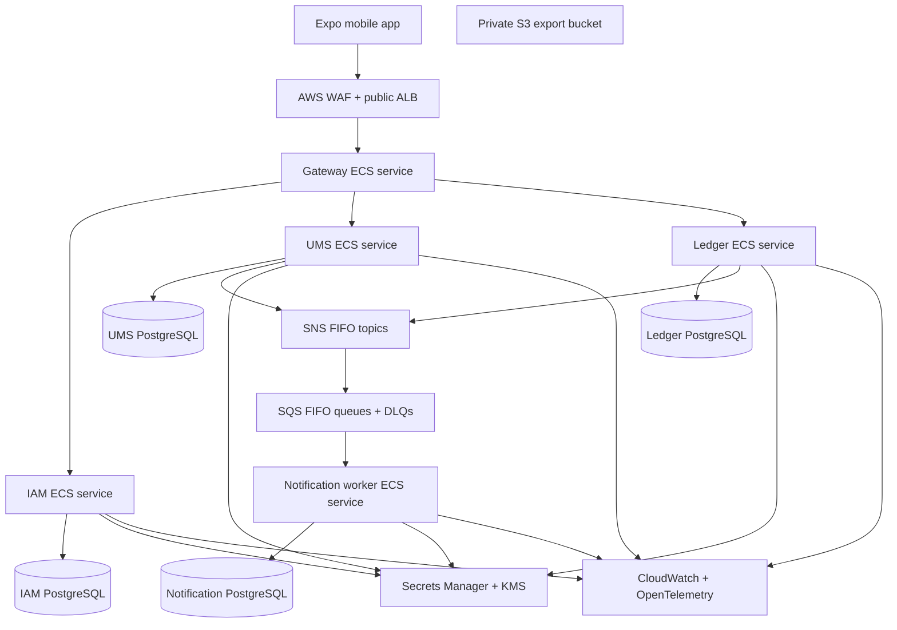

# Runtime topology, observability, and delivery

## Decision

Dutch requires a single-region, multi-AZ runtime with private networking,
isolated restorable storage, ordered durable delivery, runtime secret injection,
digest deployment, and alert delivery, stated as a capability expectation
(`dutch-managed-production-runtime`). The `distracted-dev-infra` effort provisions
the account, network, storage, messaging, and secret store. The AWS names elsewhere
in this document describe the original proposed shape, not a binding requirement:
the provider may realize the properties another way and must say which ones it
cannot. As of 2026-11-05 it has said exactly that: four of the seven required
properties are deferred and none are committed, so this document describes a
requirement set, not an available environment. Dutch supplies the service image, the endpoints and signals it must expose,
and the release record. Environment configuration is explicit and secrets never
enter source, image layers, mobile bundles, or plan output.

ADR 0010 records the ownership boundary. This document describes the runtime shape
Dutch needs, not infrastructure Dutch operates.

Production runs immutable ECR image digests on ECS Fargate behind an internet-facing ALB/WAF. Gateway is public; IAM, UMS, Ledger, Notification workers, RDS, and supporting endpoints are private. Each service has a task role, security group, database role/schema/database, migration history, and deployment unit.

## Topology

- RDS starts as one PostgreSQL Multi-AZ instance with a separate database, runtime login role, migration role, and security boundary for each owner. No task has credentials for another service's database.
- Gateway and Ledger run at least two tasks across two AZs in production. IAM, UMS, and Notification begin with two tasks where their availability/retry load justifies it; task minimums and autoscaling alarms are environment configuration, not code defaults.
- SNS FIFO topics are per producer and SQS FIFO queues per consumer. Message group is the aggregate/stream key; outbox/inbox idempotency remains the correctness mechanism.
- Valkey is permitted only for non-authoritative distributed rate limits and short-lived abuse state. S3 holds private Privacy Exports only; it has public access block, SSE-KMS, TLS-only policy, versioning, and a seven-day lifecycle expiry.

## Infrastructure and access control

The provider owns account bootstrap, networking, container runtime/registry, RDS, SNS/SQS, Secrets Manager/KMS, S3, CloudWatch, WAF, and the CI access path. Dutch states the properties it depends on and reviews the provider's plan for the resources its services run on; it holds no credentials that can create accounts, networks, or databases.

The expectation set lives in the central capability home and is not authoritative in this repository. Dutch evidence links to it rather than restating it.

Use private subnets, security groups limited to required caller/port pairs, VPC endpoints where cost/traffic justifies them, TLS externally and service-to-service, and task roles instead of static AWS credentials. KMS keys are separated for secrets, exports, and infrastructure state. Database, signing, provider, and mobile-release secrets are fetched at task/runtime or CI step scope and redacted in logs.

## Delivery and migration flow

1. Dutch CI validates format, compile/typecheck, unit/integration/contract/security suites, dependency and secret scans, container image build, release-record validity, and accessibility. The provider's plan/apply review is provider evidence, not a Dutch CI job.
2. A tagged commit builds one immutable image per changed service, records digest/SBOM/provenance, and deploys the same digest to development then staging.
3. Before a service rollout, a one-off ECS migration task using the service-specific migration role applies only backward-compatible expand changes. The service image starts only after migration health/compatibility checks pass.
4. Staging runs service, queue/outbox, contract, device E2E, restore/reconciliation, and observability checks. Production promotion is a reviewed deployment of the already-tested image digest—not a rebuild.
5. Roll back application images only when their database/API/event contracts remain compatible. Financial/source migrations are forward-repaired by an additive migration or governed correction command, never a database rewrite.

Dutch launches as a Super App module (ADR 0011): the host owns the published binary,
signing, store records, review, and rollout, while Dutch owns the module and its
portability to a standalone shell later. EAS profiles remain in the repository for that
later standalone phase and are not a launch gate. When a Dutch-owned binary is used, EAS
manages mobile development, preview, staging, and production build/update channels. Every build/update records Git commit, EAS build/update ID, runtime version, channel, app version, API/event compatibility range, environment, test evidence, approver, and rollback/forward-repair owner. OTA updates are runtime-version-gated, first promoted through staging/device validation, and disabled/rolled back only to a previously compatible bundle.

## Observability and alerts

Services emit structured, redacted logs, OpenTelemetry traces, and metrics with correlation ID, service, environment, route/command class, and safe error code. Logs exclude tokens, raw identifiers, full financial notes/descriptions, cursor/snapshot/idempotency values, request bodies, and secrets.

| Signal class | Required signals | Alert/runbook intent |
| --- | --- | --- |
| Ledger correctness | serializable retries/exhaustion, lock waits, idempotency reuse, projection reconciliation variance, correction failures | stop unsafe rollout; investigate source/projection mismatch |
| Async reliability | unpublished outbox age, queue age, consumer lag, DLQ depth/replay outcome | repair/replay without duplicate financial effects |
| API/mobile | availability, p95 latency, 4xx/5xx by code, sync expiry/full-sync rate, draft uncertainty | distinguish temporary outage from client/API regression |
| IAM/abuse | refresh reuse, invalid signatures, verification/claim/recovery failures, rate-limit blocks | contain account takeover/enumeration abuse |
| Platform | ECS/RDS health, connections, failover, storage, WAF blocks, cost/budget | capacity, security, and platform incident response |
| Release | image/runtime/update provenance, migration state, device E2E, feature compatibility | determine safe promote/rollback target |

Dashboards distinguish authoritative Ledger correctness from eventual notification delivery. A push/queue failure is never reported as a financial write failure. Every page links to a named runbook and escalation owner.

## Backup, recovery, and capacity gates

- RDS automated backups retain 35 days; production objective is RPO 15 minutes and RTO 4 hours. Quarterly—and before any irreversible schema retirement—restore to an isolated environment, validate migrations, reconcile immutable entries/projections/outbox, and record evidence.
- A restore creates a new RDS instance/cluster; the runbook includes credentials/configuration, replay-safe outbox reconciliation, source/projection validation, client impact, and cutover/forward-repair decision.
- Production capacity gates measure connection headroom, p95 reads under 500ms, accepted write latency under one second, queue/outbox age, FIFO message-group hot spots, and budget. Split the shared physical RDS instance only when noisy-neighbor, recovery-isolation, compliance, or capacity thresholds are evidenced.
- Multi-region active-active Ledger writes, self-operated Kubernetes/Kafka/PostgreSQL, and cached/broker financial truth remain out of scope.

## Required evidence before production promotion

1. Provider plan and apply evidence referenced from the runtime contract; image digest/SBOM/dependency/security evidence retained; no secret in build/log/config output.
2. Backward-compatible migration rehearsal and current/previous mobile runtime/API/event compatibility pass.
3. iOS and Android device journeys pass on the exact host build containing the Dutch module; the host build identity and Dutch module version are recorded, and the module renders in a minimal test shell.
4. RDS restore plus projection/outbox reconciliation, queue/DLQ replay, alert routing, and incident runbook exercises meet RPO/RTO targets.
5. WAF/rate-limit, task/database least privilege, TLS, backup, export lifecycle, and logging-redaction checks pass.
