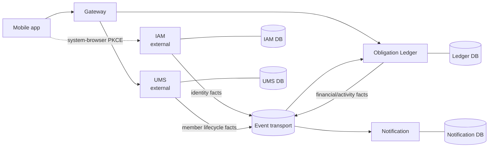

# Dutch solution structure

> This document describes Dutch-owned code and deployables. The reconciled
> portfolio topology, including the independent IAM and UMS providers, is in
> [the architecture baseline](architecture-baseline.md).

## Decision

Build Dutch as one product repository containing independently deployable
Dutch-owned services and one independently built cross-platform mobile app.
IAM and UMS are independent portfolio repositories, integrated through pinned
contracts rather than source inclusion. Every service owns its runtime,
database role/schema, migrations, API, outbox, and deployment unit. Services
communicate only through versioned HTTP contracts or immutable events; none
accesses another service's database.

Dutch-owned code is a modular monorepo, not a distributed monolith: repository
proximity is for coordinated delivery, while deployability and ownership remain
explicit. Portfolio providers remain independently owned and delivered.

## Repository layout

```text
dutch/
├── apps/
│   └── mobile/                 # React Native + Expo TypeScript application
├── services/
│   ├── gateway/                # edge routing, coarse authentication, rate limits
│   ├── ledger/                 # Groups, Expenses, Settlements, Activity, projections
│   └── notification/           # device tokens, preferences, delivery attempts
├── contracts/
│   ├── http/                   # OpenAPI sources and compatibility fixtures
│   └── events/                 # event schemas and producer/consumer fixtures
├── libraries/
│   ├── java-platform/          # dependency constraints only
│   └── java-foundation/        # non-domain primitives: correlation, errors, tracing
├── infrastructure/
│   ├── local/                  # local dependencies and deterministic test support
│   └── aws/                    # environment-specific infrastructure as code
├── docs/
│   ├── adr/
│   └── architecture/
└── build-logic/                # Gradle conventions; no business behaviour
```

The dedicated `iam` and `ums` repositories supply the respective provider
deployables and published contract bundles. Existing `services/iam` and
`services/ums` modules are legacy development prototypes, not canonical provider
implementations or future Dutch release targets.

The root Gradle build becomes a multi-project build for `services`, `libraries`, and `build-logic`. `apps/mobile` keeps its native JavaScript package manager and Expo tooling; Gradle does not own its dependency graph. CI has service-specific and mobile-specific jobs, plus contract compatibility jobs.

## Ownership and allowed dependencies

| Unit | Owns | May depend on |
| --- | --- | --- |
| Gateway | routing/rate-limit configuration; no business data | IAM token-verification material, service HTTP contracts, non-domain foundation code |
| IAM (external) | identities, credentials, verified identifiers, sessions, Dutch App Subjects | IAM-owned contracts only |
| UMS (external) | app-isolated profiles and the reconciled Dutch Member extension | UMS-owned contracts only |
| Ledger | financial records, memberships, Activity, financial/read projections | foundation code, Ledger contracts, consumed UMS event schema only |
| Notification | device tokens, preferences, delivery attempts | foundation code, consumed events only |
| Mobile | UI, local drafts, cached projections, secure session material | published HTTP contracts; no server library |

`libraries/java-foundation` may contain only technology-neutral cross-cutting code: correlation IDs, structured error serialization helpers, observability hooks, and test utilities. It must not contain entities, repositories, authorization policy, business services, database migrations, money/allocation algorithms, or an aggregate shared by two services. If such code becomes necessary, its owning service supplies it through a contract instead.

`contracts` are source-controlled compatibility boundaries, not a shared runtime domain library. A producer publishes its contract and generated clients/models may be consumed at a pinned version; consumers remain responsible for tolerant event handling and endpoint compatibility tests.

## Runtime interactions



- A mobile request has exactly one authoritative service owner after Gateway routing. Gateway does not compose domain data or coordinate financial workflows.
- IAM, UMS, and Ledger publish local outbox facts after their own committed transaction. Consumers are idempotent and may be temporarily behind.
- Ledger may use its UMS-fed local App-Subject-to-Member projection for display and authorization context. It never calls UMS or reads its database inside a financial transaction.
- Notification is downstream and best effort; its failure cannot fail a financial command.

## Documentation required from later decisions

- This document: C4-style context/container view and ownership rules.
- Ledger write-model ticket: container/component and transaction sequence diagrams plus an ADR for the chosen isolation/concurrency approach.
- Read-model, contract, identity, mobile, and runtime tickets: their own focused diagrams and ADRs only where a decision is hard to reverse and has real alternatives.

## Consequences

- IAM and UMS provider work is delivered in their dedicated repositories. Dutch prototypes are not treated as a shared application kernel or provider release path.
- Shared code has a deliberately narrow review rule. Convenience does not justify moving a domain decision into a common module.
- Local development requires independent service configuration and a local dependency topology. This cost is accepted to preserve the financial and identity boundaries already settled.
- Deployment and rollback are service-scoped. Contract evolution, outbox/inbox reliability, and cross-service test fixtures become first-class Phase 0 work.
